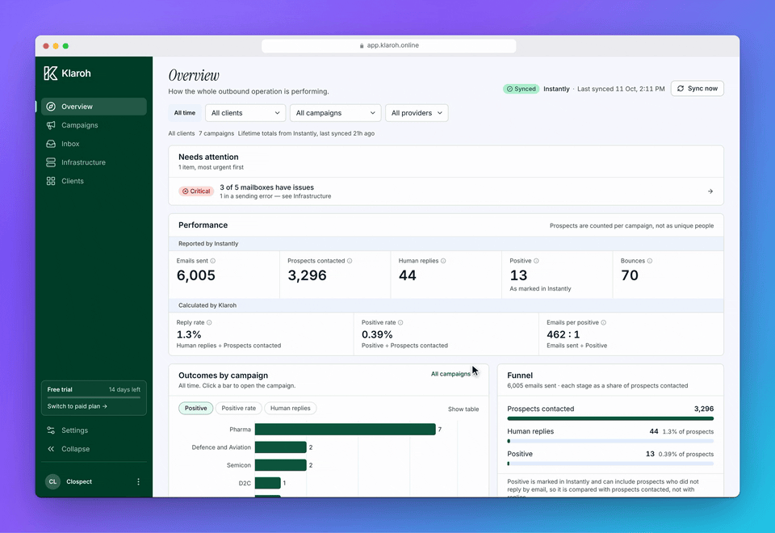
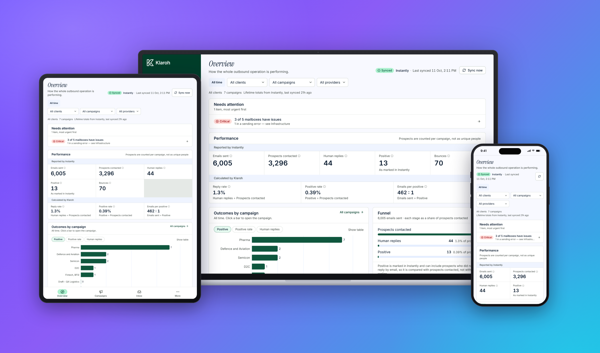
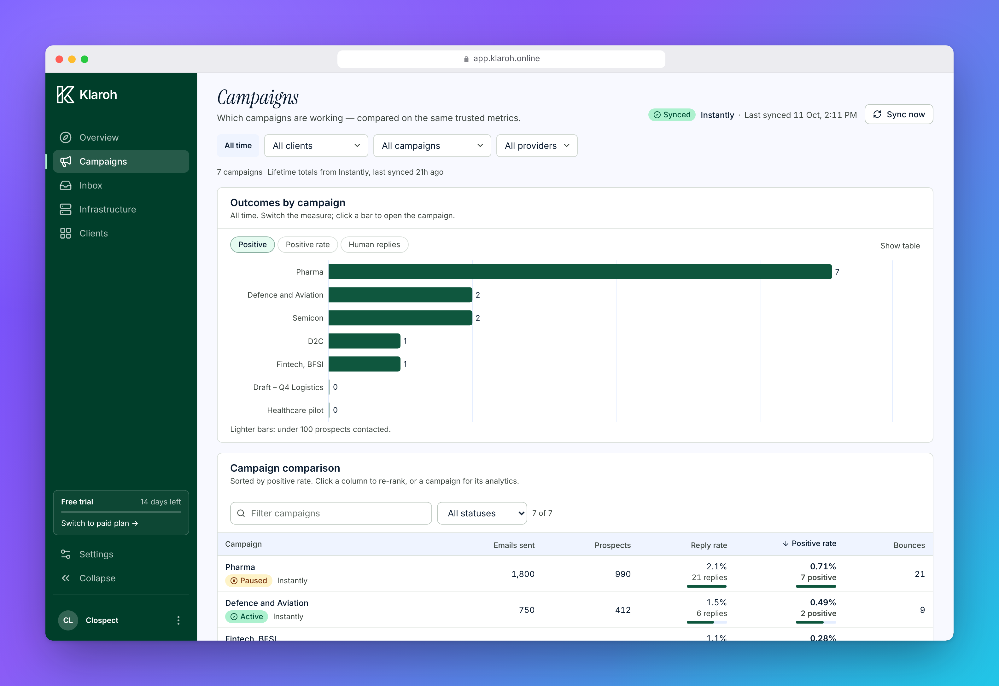
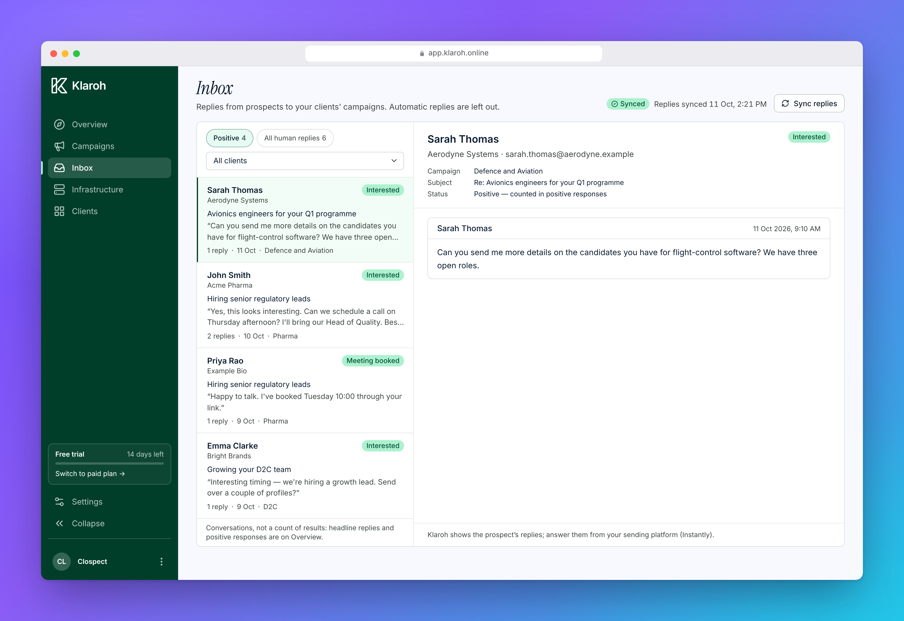
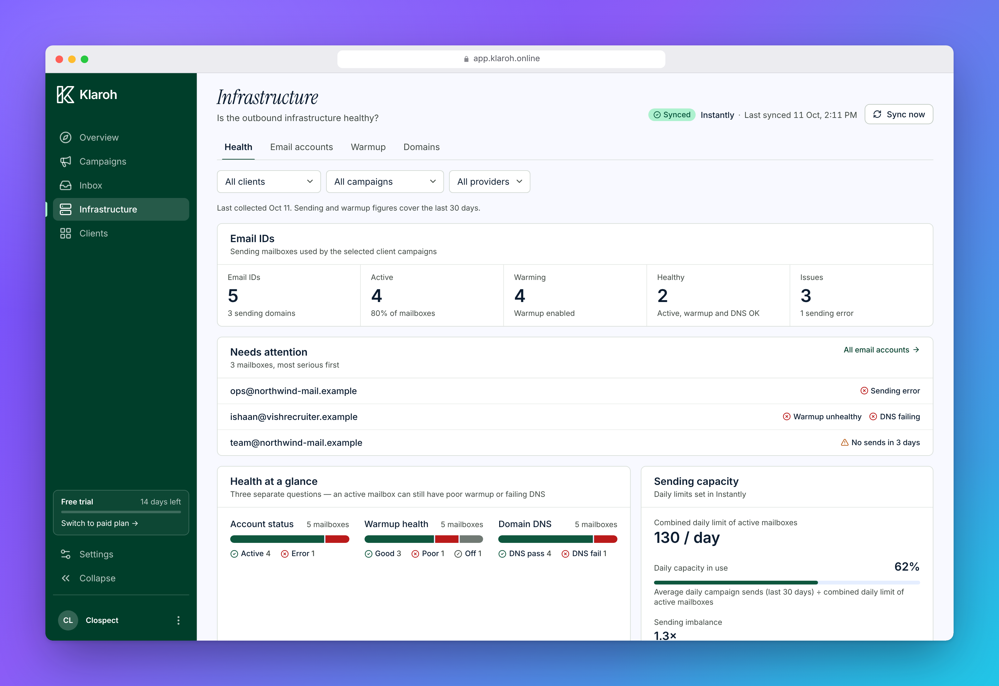
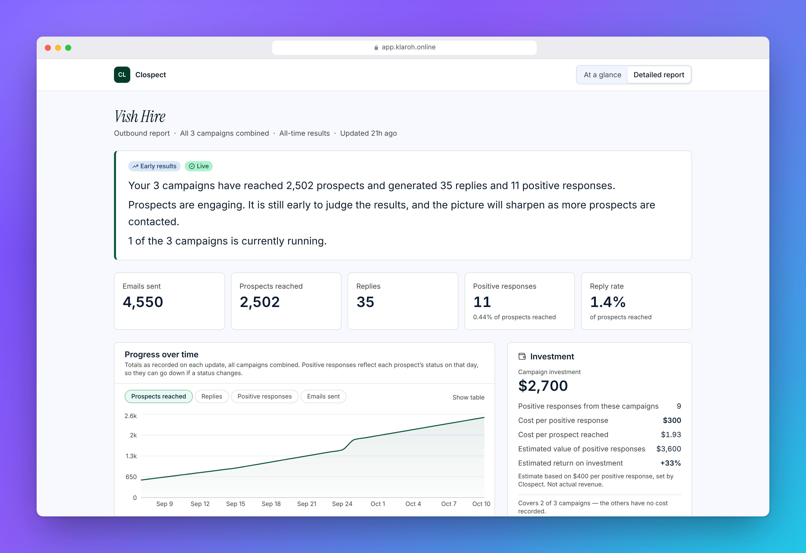
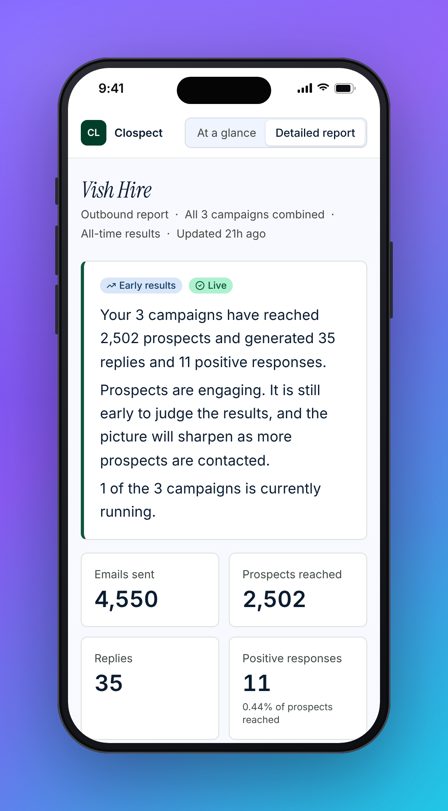

<h1 align="center">Klaroh</h1>

<p align="center">
  <b>Every client's outbound results, in one place.</b><br>
  A read-only visibility platform for cold email and lead generation agencies:
  campaign performance, replies and sending health across all clients, plus a private, branded report each client can open without logging in.
</p>

<p align="center">
  <a href="https://app.klaroh.online">app.klaroh.online</a> · <a href="docs/PRODUCT-OVERVIEW.md">Product overview</a> · <a href="#tech-stack">Tech stack</a>
</p>

<!-- reelkit:start -->
<!-- Generated by reelkit. Edit reelkit.config.yaml, then run `reelkit readme --write`. -->
<p align="center">
  <a href="docs/media/tour-framed.mp4"></a>
</p>

<p align="center">

</p>

<table>
<tr>
<td width="50%" align="center">


<br><sub>Campaign comparison</sub>

</td>
<td width="50%" align="center">


<br><sub>Unified reply inbox</sub>

</td>
</tr>
<tr>
<td width="50%" align="center">


<br><sub>Mailbox and domain health</sub>

</td>
<td width="50%" align="center">


<br><sub>Client portal</sub>

</td>
</tr>
</table>
<!-- reelkit:end -->

<p align="center"><sub>Screenshots and the tour above use seeded demo data; fictional clients, no real prospects.</sub></p>

> **Status:** private beta (V2). Instantly is the only working provider; Smartlead is listed as "on the way".
> Klaroh reads campaign, reply and mailbox data from the agency's sending tool and **never sends email**.

## The product in four views

| | |
|---|---|
| **Overview.** Cross-client performance, a "needs attention" list, funnel and outcomes by campaign. Only metrics that can be verified are shown. | **Campaigns.** Every campaign compared on one set of definitions, with per-campaign sequence-step analysis. |
| **Inbox.** Prospect replies from every client in one place, filtered to positive or human replies. Automatic replies are left out. | **Infrastructure.** Mailbox status, warmup health, sending capacity and SPF / DKIM / DMARC checks per domain. |

## What clients see

Each client gets a private, no-login report at a secret, rotatable link. The agency chooses which figures and campaigns are shown, and can add cost and value figures to show cost per positive response and estimated return.

<p align="center">
  
  
</p>

## What it does

| Area | Route | Purpose |
|---|---|---|
| **Overview** | `/dashboard` | Cross-client performance, "needs attention" list, outcome rankings, replies per day, progress over time |
| **Campaigns** | `/campaigns`, `/campaigns/[id]` | Compare campaigns on one set of metrics; per-campaign detail with sequence-step analysis and sending mailboxes |
| **Inbox** | `/inbox` | Prospect replies across clients; positive / human filters; conversation view. Automatic replies are excluded |
| **Infrastructure** | `/infrastructure`, `/infrastructure/accounts`, `/infrastructure/warmup`, `/infrastructure/domains` | Mailbox status, warmup health, sending capacity, SPF / DKIM / DMARC / MX per domain |
| **Clients** | `/clients`, `/clients/[slug]` | Create clients, connect a provider, import campaigns, sync status |
| **Client portal settings** | `/clients/[slug]/portal` | Choose what the client sees, enter cost and value figures, preview, copy or rotate the link |
| **Client portal** | `/c/[slug]/[token]` | Private, no-login, branded report (at-a-glance and detailed views) |
| **Settings** | dialog | Workspace profile and logo, integrations, account, billing & plan |
| **Landing site** | `/`, `/resources` | Marketing page with product tour and waitlist, plus research articles |

**Current scope**

- Agency signup, login and password reset. Each agency is a **workspace** whose users are members (`owner` / `admin` / `member`).
- Client CRUD with plan-enforced limits (trial 3, solo 3, growth 10, agency 20) and a 14-day trial.
- Provider connection once per workspace (Instantly API v2): validated, encrypted, replaceable, disconnectable (history is kept).
- Client onboarding: create client → connect provider → pick that client's campaigns → import.
- Sync of client-linked campaigns only: scheduled daily (Vercel Cron), refreshed when pages open, and a manual Sync button. Daily history snapshots and a sync log (`sync_runs`) back every status the UI shows.
- Reply sync into a unified inbox.
- A shared metric layer with one fixed definition per metric. Open rate, meetings, revenue and bounce rate are deliberately withheld because they cannot be verified.
- Infrastructure analytics: mailbox flags, warmup health, capacity use, domain DNS checks.
- Client portal with simple / advanced modes, selectable figures and campaigns, investment and cost-per-positive figures in any ISO currency, and a rotatable secret link.
- Email via Resend: welcome and client-invite emails, with an audit log.
- Billing page (contact-to-upgrade, no payment processor).

## Tech Stack

| Layer | Technology | Version |
|---|---|---|
| Framework | Next.js (App Router) | 16.2.7 |
| Runtime | React | 19.2.4 |
| Language | TypeScript | ^5 |
| Styling | Tailwind CSS v4 | ^4 |
| Database | Supabase (PostgreSQL + RLS) | supabase-js ^2.107.0 |
| Auth | Supabase Auth (email/password) | @supabase/ssr ^0.10.3 |
| Email | Resend | ^6.12.4 |
| Charts | Recharts | ^3.8.1 |
| Animation | Framer Motion | ^12.40.0 |
| Icons | Lucide React | ^1.17.0 |
| Encryption | `node:crypto` (AES-256-GCM); legacy crypto-js values are migrated on read | |
| Hosting / cron | Vercel (`vercel.json` runs `/api/sync` daily at 04:00 UTC) | |

> **Next.js note:** this version has breaking changes from older releases. See [`AGENTS.md`](./AGENTS.md) and read `node_modules/next/dist/docs/` before changing framework-level code.

## Local Development

### Prerequisites

- Node.js 20+
- A Supabase project (free tier works)
- A Resend account (free tier works)
- An Instantly account with an API v2 key (to see real data)

### Setup

1. **Clone and install**

   ```bash
   git clone <repo-url>
   cd klaroh
   npm install
   ```

2. **Environment variables**

   ```bash
   cp .env.example .env.local
   ```

   Fill in every value; `.env.example` explains each one.

   | Variable | Used for |
   |---|---|
   | `NEXT_PUBLIC_SUPABASE_URL`, `NEXT_PUBLIC_SUPABASE_ANON_KEY` | Browser + server Supabase clients (RLS enforces access) |
   | `SUPABASE_SERVICE_ROLE_KEY` | Server-only admin client. Never expose to the browser |
   | `RESEND_API_KEY`, `EMAIL_FROM_ADDRESS` | Email. Without a verified sending domain, Resend's sandbox sender is used |
   | `ENCRYPTION_KEY` | Encrypts provider API keys at rest. The app refuses to start if it is missing or left at the placeholder |
   | `CRON_SECRET` | Authenticates the scheduled `GET /api/sync` |
   | `NEXT_PUBLIC_TALLY_FORM_URL` | Waitlist form linked from the landing page |
   | `NEXT_PUBLIC_SITE_URL` | Canonical URL for SEO / share metadata |
   | `OPENAI_API_KEY` | Reserved for planned AI work. Not used by the app yet |

3. **Apply database migrations**

   Schema lives in `supabase/migrations/` (timestamped, ordered, non-destructive). For a **new** Supabase project:

   ```bash
   supabase link --project-ref <ref>
   supabase db push
   ```

   For the **existing** production database (which already has the V1 schema) do not push the baseline. Follow "Applying V2 to production" in [`supabase/README.md`](./supabase/README.md). Files under `supabase/manual-apply/` are for hand-applying to a hosted database in the Supabase SQL editor; check that README before running anything.

4. **Run**

   ```bash
   npm run dev
   ```

   Open [http://localhost:3000](http://localhost:3000).

The `agency-logos` storage bucket is created automatically on the first logo upload.

### Scripts

| Command | What it does |
|---|---|
| `npm run dev` / `build` / `start` | Next.js dev server, production build, production server |
| `npm run lint` | ESLint |
| `npm run typecheck` | `tsc --noEmit` |
| `npm test` | Node test runner over `src/**/__tests__/*.test.ts` (Instantly adapter, paging, retries, metrics, portal, replies, sync, encryption, cron auth, …) |
| `npm run db:test` | SQL tests: security, V2 behaviour, V1→V2 backfill, portal, replies. Needs a local PostgreSQL |
| `npm run e2e:test` | Real sync code → PostgREST → PostgreSQL. Needs PostgreSQL and a PostgREST binary (`POSTGREST_BIN`) |
| `npm run browser:test` | Browser checks against a seeded local stack (`supabase/tests/browser`) |

## Project Structure

```
klaroh/
├── src/
│   ├── proxy.ts                  Auth proxy (Next 16 "middleware"): gates everything except /, /auth, /c, /resources, /api
│   ├── app/
│   │   ├── page.tsx              Landing page (signed-in visitors are redirected to /dashboard)
│   │   ├── (dashboard)/          Signed-in app
│   │   │   ├── dashboard/        Overview
│   │   │   ├── campaigns/        Comparison + [id] detail
│   │   │   ├── inbox/            Reply inbox
│   │   │   ├── infrastructure/   Summary, accounts, warmup, domains
│   │   │   ├── clients/          Client list, [slug] detail, [slug]/portal settings
│   │   │   └── settings/         Billing page (settings itself is a dialog)
│   │   ├── auth/                 Login, signup, reset password (+ confirm)
│   │   ├── c/[slug]/[token]/     Private client portal (legacy slug-only link shows a "ask for the new link" page)
│   │   ├── resources/            Research articles
│   │   ├── api/                  Server routes (see below)
│   │   └── globals.css           Design tokens (Tailwind v4 @theme)
│   ├── components/
│   │   ├── analytics/            Shared analytics UI: panels, charts, tables, attention list
│   │   ├── inbox/  integrations/  portal/  sync/  nav/  landing/  ui/
│   │   └── *.tsx                 Sidebar, modals, mobile nav, settings dialog
│   ├── content/resources/        Article content
│   └── lib/
│       ├── analytics/            Pure metric, infrastructure, replies, steps, ranking, history and portal logic
│       ├── data/                 Server data access (workspace, clients, analytics, inbox, portal, integrations)
│       ├── providers/            Provider catalog + adapters (Instantly) behind provider-neutral types
│       ├── sync/                 Sync orchestration, campaign / reply stores, sync status
│       ├── email/                Resend sender + templates
│       ├── supabase/             Browser, server and admin clients
│       ├── instantly-api.ts      HTTP client (paging, retries)
│       ├── instantly-mappers.ts  Instantly → normalized shapes
│       ├── encryption.ts  plan-limits.ts  rate-limit.ts  cron-auth.ts  slug-utils.ts  types.ts
│       └── __tests__/            Unit tests
├── supabase/                     migrations/ (source of truth), manual-apply/, verify/, tests/, README.md
├── public/marketing/             Product screenshots (desktop + mobile) and web images
├── docs/                         PRODUCT-OVERVIEW.md, design.md, landing-page-*.md, AUDIT.md, archive/
└── .env.example
```

## Data Model (V2)

| Table | Purpose |
|---|---|
| `workspaces` | One per agency: name, website, logo, timezone, plan (the tenant) |
| `workspace_members` | Users in a workspace and their role |
| `clients` | The workspace's clients: name, slug, status, email, portal token and settings |
| `integrations` | Connected providers per workspace (one per provider, shared by all clients). The encrypted key is readable and writable only server-side; users see `enabled` / `has_credential` |
| `campaigns_v2` | One row per provider campaign a client uses (`UNIQUE(integration_id, external_id)`). Klaroh `display_name` is kept apart from the provider `name`; `unavailable_since` is set when the provider stops returning it |
| `campaign_stats` | Daily snapshots, one row per campaign per day, cumulative counters |
| `campaign_client_map` | Campaign ↔ client link. **This is the sync scope**: only linked campaigns are stored and synced |
| `sync_runs` | One row per sync: trigger, status (`success` / `partial` / `failed`), counts, error |
| Reply, account, domain and step tables | Synced replies, mailbox and domain state, per-day sending, per-step statistics (see migrations `outbound_analytics` and `reply_inbox`) |
| `email_logs` | Audit trail for outbound email |
| `rate_limits` | Atomic per-key counters (admin-only) |
| `campaign_legacy_map`, `agency_details`, `campaigns`, `remarks` | V1 archive and back-fill mapping. Read-only history; the app no longer reads or writes them |

### Data flow

```
Instantly API → instantly-api.ts → instantly-mappers.ts → providers/instantly adapter
  (NormalizedCampaign, CampaignStatSnapshot, accounts, domains, replies)
  → sync/* stores → campaigns_v2 · campaign_stats · replies · sync_runs
  → data/* + RPCs → lib/analytics/* (pure metric layer) → UI and client portal
```

### Client onboarding

```
Create client → client page → "Connect your sending tool"
→ use the workspace connection, or enter an API key (validated, stored encrypted, never returned)
→ discovery: GET /api/integrations/:id/campaigns (transient, nothing stored)
→ import: POST /api/clients/:id/campaigns (only the selected campaigns: stored, snapshotted, linked)
→ dashboards render the returned campaigns; later syncs cover only client-linked campaigns
```

## API Routes

| Method | Path | Auth | Purpose |
|---|---|---|---|
| POST | `/api/create-client` | Required | Create client; enforces plan limits and the trial gate |
| POST | `/api/update-client-name` | Required | Rename client / update slug |
| POST | `/api/update-client-status` | Required | Set client status (active / paused / ended) |
| POST | `/api/delete-client` | Required | Delete client (ownership checked) |
| POST | `/api/delete-campaign` | Required | Remove a campaign from a client (history kept) |
| POST | `/api/clients/:id/campaigns` | Required | Import the selected provider campaigns for a client |
| GET | `/api/integrations` | Required | Provider catalog + the workspace's integrations (status only) |
| POST | `/api/integrations` | Owner/admin | Connect or replace a key (validated first) |
| DELETE | `/api/integrations/:id` | Owner/admin | Disconnect: stop syncing, purge the key, keep data |
| GET | `/api/integrations/:id/campaigns` | Required | Discover campaigns in the provider account (not stored) |
| POST / GET | `/api/sync` | Required / cron | Sync client-linked campaigns (POST: this workspace; GET: cron, all workspaces, `CRON_SECRET`) |
| GET | `/api/sync/status` | Required | Current sync status for the UI |
| POST | `/api/replies/sync` | Required | Sync replies for the inbox |
| PUT | `/api/client-portal` | Required | Save a client's portal settings and per-campaign economics |
| POST | `/api/client-portal/rotate` | Required | Issue a new secret portal link (old one stops working) |
| GET / PATCH | `/api/workspace` | Required | Read / update workspace profile |
| POST | `/api/upload-logo` | Required | Upload agency logo |
| GET | `/api/plan-status` | Required | Plan, client count, trial status |
| POST | `/api/send-onboarding-email` | Public, rate-limited | Welcome email on signup |

## Design System

Full reference: [`docs/design.md`](./docs/design.md). Brand rules: [`CLAUDE.md`](./CLAUDE.md).

- **Fonts:** Instrument Serif (italic, page titles), Inter (everything else), Geist on the landing page.
- **Colors:** Material 3 tokens in `src/app/globals.css`. Primary `#003E2A` (actions and chrome), primary container `#0F573E` (data), surface `#F8F9FF`, error `#BA1A1A`.
- **Navigation:** a single config (`src/components/nav/nav-config.ts`) feeds the desktop sidebar, mobile bottom bar and "More" sheet.

## Key Architecture Decisions

- **Workspace tenancy.** Every owned row carries `workspace_id`; RLS allows workspace members only, and triggers derive tenancy from the parent row, so a caller cannot write into another workspace.
- **Provider adapters.** The database and UI never use a provider's field names. Each provider is an adapter that produces normalized types; sync and storage are provider-neutral. Adding a provider means adding an adapter and a catalog entry.
- **Sync scope is the client–campaign link.** Klaroh never stores a whole provider account.
- **One metric layer.** `lib/analytics/metrics.ts` defines every metric (definition, source, calculation, reliability). The portal and dashboards only choose and word them; unverified metrics are hidden, and a missing value is never shown as 0.
- **Secret portal links.** Slugs are guessable, so the portal needs a per-client token that can be rotated. Public reads go through scoped `SECURITY DEFINER` functions that return one client's data and no internal ids. Portal pages are `noindex` with no referrer.
- **Server-side plan enforcement.** Limits are checked in `/api/create-client` with the service-role client; `/api/plan-status` is for UI gating only.
- **AES-256-GCM key storage.** Provider keys are encrypted with a random IV per record and are never returned to the browser. `ENCRYPTION_KEY` is a single point of failure: rotate and re-encrypt if it leaks.
- **No payment processor.** Upgrades are handled by email (`hello@klaroh.app`).

## Known Issues & Deferred Work

- **Sending domain not yet verified in Resend.** Until `EMAIL_FROM_ADDRESS` is on a verified domain, mail goes from Resend's sandbox sender.
- **Only Instantly is supported.** Smartlead appears in the catalog as unavailable.
- **Data is synced, not live.** The UI always shows the last sync time and surfaces failures.
- **Bounce rate and open rate are withheld** until their units can be verified.
- **Lint:** some pre-existing `react-hooks/set-state-in-effect` errors remain in client components.
- **OpenAI** is configured for planned AI features but nothing in the app calls it yet.
- **Rate limiting fails open** if the rate-limit RPC errors.
- `docs/PRODUCT-BIBLE.md` and `docs/AUDIT.md` predate V2 and describe the retired V1 product (remarks, Smartlead, Demo Data). Treat them as history.

## Deployment

Deploy to Vercel and set these in Settings → Environment Variables:

```
NEXT_PUBLIC_SUPABASE_URL
NEXT_PUBLIC_SUPABASE_ANON_KEY
SUPABASE_SERVICE_ROLE_KEY
RESEND_API_KEY
EMAIL_FROM_ADDRESS
ENCRYPTION_KEY
CRON_SECRET
NEXT_PUBLIC_TALLY_FORM_URL
NEXT_PUBLIC_SITE_URL
OPENAI_API_KEY        # optional, reserved
```

`NEXT_PUBLIC_*` variables are exposed to the browser; all others are server-only. `vercel.json` schedules the daily sync.

## Contact

[hello@klaroh.app](mailto:hello@klaroh.app)

## Regenerating the media

The images and GIFs in `docs/media/` are produced by [reelkit](https://github.com/jithujsam-cloud/reelkit) from [`reelkit.config.yaml`](reelkit.config.yaml), against a throw-away local stack (Postgres, PostgREST and the production build) seeded by [`supabase/tests/browser/seed.sql`](supabase/tests/browser/seed.sql). See [`supabase/tests/browser/run.sh`](supabase/tests/browser/run.sh) for how that stack is assembled. Use a fake session cookie for the seeded user and run `reelkit all` from the repo root.
